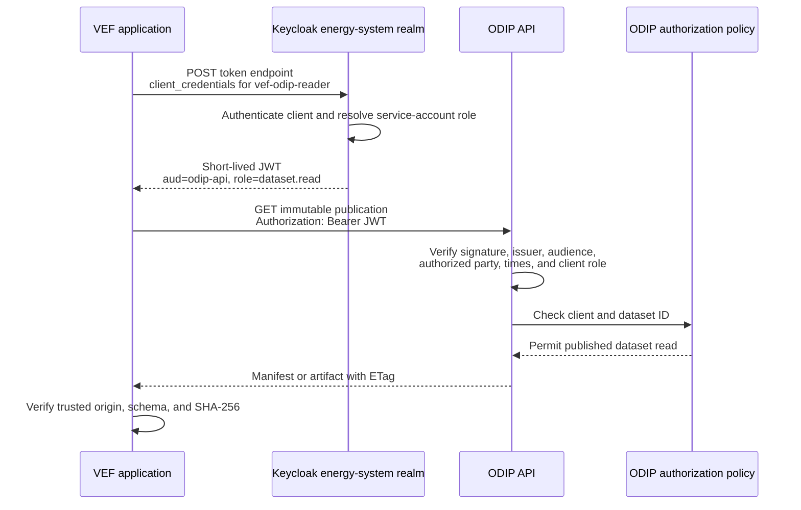

# VEF-to-ODIP authentication flow and threat notes

**Status:** Gate 0 baseline
**Related decisions:** [DEC-03](../decisions/DEC-03-connectivity.md), [DEC-04](../decisions/DEC-04-identity.md)

## Sequence

VEF refreshes the token before expiry and does not forward it to any host other
than the configured ODIP origin. ODIP validates the token locally using cached
Keycloak signing keys; it contacts Keycloak discovery/JWKS endpoints only to
initialize or refresh those keys.

## Trust boundaries

- Developer Platform routing and egress policy controls where traffic may go;
  it does not grant ODIP application permissions.
- Keycloak authenticates the VEF client and issues a bounded access token.
- ODIP is the final authority for dataset and operation authorization.
- VEF independently validates publication origin, schema, and artifact digests
  after ODIP authorizes retrieval.

## Threats and controls

| Threat | Required control | Acceptance evidence |
| --- | --- | --- |
| Stolen VEF credential | Secret is injected only into VEF, rotated every 90 days, and absent from images and logs. | Retired secret cannot obtain a token; secret-scanning and log checks pass. |
| Stolen access token | Five-minute lifetime, TLS, audience restriction, and no token logging. | Expired and wrong-audience tokens return `401`. |
| Token issued for another client | ODIP validates `aud`, authorized party, and the Keycloak client role. | Token for an unrelated client returns `401` or `403` without data. |
| Valid client reads another dataset | ODIP applies its local client-to-dataset allow-list after token validation. | Request for a prohibited dataset returns `403`. |
| VEF attempts an ODIP write | The service account has only `dataset.read`, and ODIP checks operation authorization. | Catalog, ingestion, and publication writes return `403`. |
| Malicious artifact URL or redirect | VEF accepts only relative artifact paths resolved against the configured ODIP origin and rejects cross-origin redirects. | External URL and redirect fixtures fail before retrieval. |
| DNS or certificate interception | HTTPS certificate and hostname verification are mandatory; endpoints are configured, not read from publications. | Invalid certificate or hostname fails closed. |
| Signing-key rotation or discovery outage | ODIP caches still-valid keys, refreshes on an unknown key, and rejects the token if refresh fails. | Known cached key continues to validate; unknown key with failed refresh returns `401`. |
| Excessive network access | Project egress permits only the approved ODIP and Keycloak HTTPS destinations. | ODIP and token requests succeed; unrelated egress is denied. |
| Sensitive-data leakage | Customer details, secrets, and tokens are excluded from logs, traces, publications, results, and explanations. | Automated log assertions find only approved correlation identifiers. |

## Failure behavior

- Keycloak unavailable before token acquisition: VEF does not call ODIP without
  authentication and reports an operational dependency failure.
- ODIP unavailable after VEF verified an immutable publication: VEF may use only
  that exact cached publication and records its version and checksums.
- Keycloak signing-key refresh unavailable: ODIP may validate with an applicable
  cached key; an unknown key fails closed.
- Authorization failure: VEF does not retry `401` or `403` indefinitely and does
  not fall back to anonymous access.
